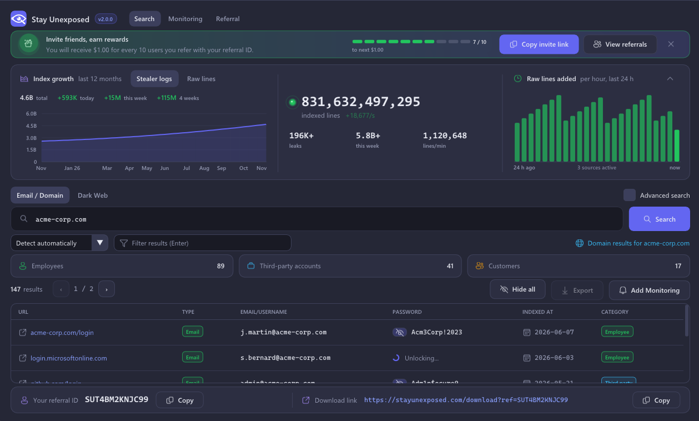

<p align="center">
  
</p>

<p align="center">
  <strong>Stay Unexposed</strong><br />
  A Windows desktop app for searching leaked credentials and monitoring your emails and usernames, with a
  desktop alert as soon as a new leak appears.
</p>

---

<p align="center">
  
</p>

# Stay Unexposed — Leaked Credential Search & Monitoring

## What it is for

- **Search** — look up an email, username or domain across stealer logs and breach data in one box.
- **Investigate** — narrow results down with advanced filters on URL, login, password and email fields.
- **Watch** — save emails and usernames and have them re-checked automatically every day.
- **Get alerted** — a desktop notification the moment a leak you haven't seen before shows up.
- **Export** — save any result set to CSV in your Downloads folder.

## Quick start

1. Download `StayUnexposed.exe` and run it (single file, no installer).
2. Type an email address, username or domain into the search box and press <kbd>Enter</kbd>.
3. Click **Add Monitoring** above the results to add the value to your watchlist.
4. Open **Monitoring** to set **Daily check at** and turn on **Start with Windows**.


---

## Features

### Searching

**Email / Domain** — one input for everything. The app detects whether you typed an email address,
a username or a domain and runs the right search:
- Email or username: stealer-log results with URL, login, password, date and password strength.
- Domain: a summary of affected **employees**, **third parties** and **customers**, then the leaks per category.

**Advanced search** — combine include and exclude filters on:
- URL, URL host, URL domain, scheme, TLD and port
- Username / email, password, and SHA-1 prefixes of either
- Email host, email domain and email TLD

**Dark web** — search posts from forums and channels, with title, source, author, target and date.

**Unlocking** — passwords are unlocked one row at a time for the first 30 rows, with a short pause
between rows.

**Export** — any paged search can be exported in the background to CSV in your Downloads folder
(e.g. `leaks_acme-corp.com.csv`). Fields are escaped to RFC 4180 and protected against
spreadsheet formula injection.

### Monitoring

- **Watchlist** — save emails and usernames; adding one records a baseline, so you're not alerted
  about leaks you already know.
- **Daily check** — every value is re-checked once a day at the time you choose (default 08:00), or
  at start-up if a run was missed.
- **Alerts** — only leaks that have never been seen before raise a desktop notification.
- **Tray** — keep the app running in the system tray when the window is closed.
- **Start with Windows** — per user, no admin rights needed.

### Dashboard

- **Index growth card** (can be hidden) — weekly growth over the last 12 months for stealer logs and
  raw lines, a live indexed-lines counter, and raw lines added per hour over the last 24 hours.
- **Usage and plan** — your points, quota and plan in the header.

### Referrals

- Every install gets a referral ID; share your download link (`stayunexposed.com/download?ref=SU...`).
- An app downloaded from a referral link picks up the inviter automatically on first run.
- You can also enter who invited you on the **Referral** tab.
- Rewards: `floor(invited users / 10) x $1`.

### Updates

- The app checks for a new version shortly after start and then every hour.
- New versions download and install by themselves, then the app restarts.
- A signed app only accepts updates signed by the same publisher.

---


## Download

Grab [StayUnexposed.exe](https://github.com/StayUnexposed/StayUnexposed-windows/releases/download/latest/StayUnexposed.exe).
The current version is in the [`VERSION`](VERSION) file.

## Development

Requirements: Visual Studio 2022 (or Build Tools) with the C++ workload, and CMake 3.24+.
Dear ImGui, nlohmann/json and SQLite are downloaded automatically at configure time.

```powershell
cmake -B build -G "Visual Studio 17 2022" -A x64
cmake --build build --config Release
```

| Command | Description |
| :--- | :--- |
| `cmake --build build --config Release` | Build `build\Release\StayUnexposed.exe` (single file, static runtime) |
| `cmake --build build --config Debug` | Debug build |
| `build\Release\su_tests.exe` | Unit tests (offline) |
| `build\Release\su_tests.exe --live` | Check the live API (uses quota) |
| `build\Release\su_tests.exe --register` | Register this PC with the referral server and read back its invitees |
| `build\Release\su_tests.exe --run-agent` | Download and start the companion updater |
| `build\Release\su_tests.exe --read-stamp <file>` | Print the inviter stamped into a downloaded exe |

**Versioning** — the version lives only in the [`VERSION`](VERSION) file (`major.minor.patch`); CMake
generates `Version.h` and the exe's file properties from it. The product name is defined only in
`src/AppInfo.h`.

---

## Project structure

```
desktop/
├── CMakeLists.txt
├── VERSION             # app version (single source)
├── res/                # icon and Windows resources
├── src/
│   ├── AppInfo.h       # product name and branding
│   ├── main.cpp        # window, Direct3D 11, message loop
│   ├── api/            # WinHTTP client, typed API client, JSON models, mock data
│   ├── core/           # SQLite storage, utilities, autostart, hardware ID, signatures
│   ├── services/       # watch service, CSV export, referrals, updater, companion
│   └── ui/             # ImGui views (Search, Monitoring, Referral), tray, style
└── tests/
    └── test_core.cpp   # parsing, request building, scheduling and diff tests
```

## Security and privacy

- The API host is stored masked in the executable, so it does not appear as plain text.
- Network traffic still goes to the API host and can be seen with network tools.
- The referral server only receives your referral ID (and your inviter's, when entered).
- Updates must come from the same publisher as the running app when it is signed.
- CSV exports are protected against spreadsheet formula injection.
